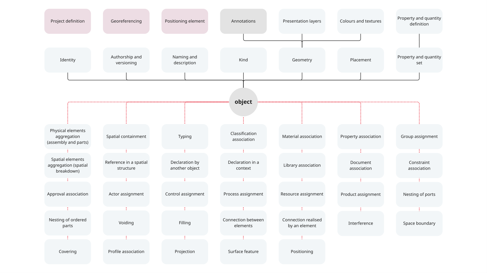

# IFC 4.3 and IFCX: modelling concepts comparison

*Draft of 1 Oct 2026, for IFCX group's review. Structure and wording will change. The IFC 4.3 column was checked against the IFC4X3 schema on 1 Oct. The IFCX and Supported cells were filled on 1 Oct from the register.mf file. Where Alpha shows nothing, the cell says so.*

This document helps readers see how the same IFC functionalities are represented in the step-based IFC (e.g., IFC 4.3) and in IFCX. It lists **what** the concepts are that a model can represent. For each concept, it says **how** IFC 4.3 and IFCX, respectively, represent it.

It is written for:

- IFC developers who want a high-level summary of what changes in how the IFCX implementation maps to the best-known IFC.
- The IFCX group, to validate the latest assumptions about IFCX and to align the group's understanding of the prototype.
- The group and practitioners, to decide the scope of the core: what belongs in the core of the standard and what is an extension.

**Concept and mechanism.** A *concept* is something that can be represented, in IFC 4.3 and in IFCX alike: identity, placement, a material association. A *mechanism* is how a concept is represented: in IFC 4.3 an entity, an attribute or a relationship; in IFCX a node, an attribute, a child link or an inheritance link, as listed in the [register](register.md). In IFC 4.3, for example, the concept of an object's kind has several mechanisms: a subclass, the `PredefinedType` enumeration, `ObjectType` text and a classification reference. They differ, also in their effect on the schema, but they all exist. The table asks, for each concept, which mechanism IFCX uses. The [glossary](glossary.md) defines both terms.

**Where the concepts come from.** Rows 1 to 9 come from walking the attributes of one IFC 4.3 entity, `IfcDoor`, from `IfcRoot` down. The walk is kept at the end of the document. Rows 10 to 15 are concepts that do not hang off an object's attributes, such as the project definition and georeferencing. Relationships and entities that these two routes do not reach are not covered, and the commentary under the table lists them.

## IFCX (Alpha) in a few lines

An IFCX model is a set of **nodes**. A node has a path that identifies it, and carries attributes, children and links to the nodes it inherits from. Different parties state this information in their own **layers**, and what a user reads is the **composed model**, the result of combining the layers. Attribute names are namespaced, for example `bsi::ifc::prop::FireRating`, and each has a schema that gives its data type. The kind of an object is stated by an attribute holding an IFC class code, such as `IfcWall`, so the class names of IFC 4.3 stay in use. The [glossary](glossary.md) defines these terms.

## How to read the table

- **In IFC 4.3:** the mechanisms the schema offers for the concept.
- **In IFCX:** the mechanism used in Alpha, with links to the register, or to the section [How Alpha encodes some IFC concepts](#how-alpha-encodes-some-ifc-concepts) at the end of this document.
- **Supported:** *yes*, *partly* or *no*. This says whether Alpha shows the concept, not whether IFCX could ever do it. *no* means not shown in Alpha. Preliminary.

---

<strong>IFC4x-IFCX concepts view</strong> (open to view the image)

---

## Concepts

| # | Concept | In IFC 4.3 | In IFCX (Alpha) | Supported |
|---|---|---|---|---|
| 1 | **Identity** | `GlobalId` (required, unique, encoded GUID); `Tag` on elements as a secondary identifier; file-local `#N` (not an identity) | Node path, a UUID by convention and not checked ([`M07`](register.md#m07-uuid-identifiers), [Q33](open-questions.md#q33--identifier-uuid-path-or-uri)); context path for a node inside the tree ([`M08`](register.md#m08-context-paths)). No `GlobalId` attribute. `Tag` equivalent unknown | partly |
| 2 | **Authorship and versioning** | `OwnerHistory` (`IfcOwnerHistory`): owning user and application, state, change action, creation and last-modification times and users. Optional since IFC 4. The same entity carries the versioning information of the object | Author and timestamp once per layer in the layer header, with a `dataVersion` in the header and versions written into layer names ([`M11`](register.md#m11-layer-header-with-author-time-and-version)). Nothing per object. Lost on composition ([Q27](open-questions.md#q27--provenance-per-layer-or-per-opinion)). No change history from which an earlier state can be reproduced | partly |
| 3 | **Naming** | `Name`, `Description`: human readable, not unique | Ordinary attributes, e.g. `bsi::ifc::prop::Name`. A second name exists in the tree: the child name in `children` ([`M04`](register.md#m04-child-links-build-the-tree)). Are they the same? No code concept | yes |
| 4 | **Kind** | The entity itself (a different class for a different kind; `IfcDoor` has no subtypes in 4.3); `PredefinedType` enum; `ObjectType` text (`USERDEFINED`); second-level enum (`OperationType`); type object; classification reference | Class is a value: `bsi::ifc::class` with predefined type appended ([IFC class attribute](#ifc-class-attribute)); type as inherited node ([`M05`](register.md#m05-inheritance)); one attribute per classification system ([`M12`](register.md#m12-namespaced-attributes-with-schemas)). No class hierarchy in the file; no second-level enum shown | partly |
| 5 | **Placement** | `ObjectPlacement`: local placement (relative to another placement), grid placement or linear placement (along a curve) | Transform relative to the parent in the tree ([`M18`](register.md#m18-transform-relative-to-parent)). Basis is always the parent ([Q60](open-questions.md#q60--how-a-placement-is-represented)) | partly |
| 6 | **Geometry** | `Representation`: shape with several representations, each with context, identifier and type | Geometry attribute in USD or glTF ([`M17`](register.md#m17-usd-and-gltf-geometry)). No contexts or representation identifiers | partly |
| 7 | **Relationships** | Objectified `IfcRel*` with own `GlobalId` and attributes. Each meaning below is a separate relationship |  |  |
| 7.1 | Physical elements aggregation (assembly and parts) | `IfcRelAggregates` between objects, e.g. an `IfcElementAssembly` and its parts, or a stair and its flights. It can be applied to all subtypes of `IfcObjectDefinition`. Inverses `Decomposes` (at most one whole), `IsDecomposedBy` | Parts are `children` of the whole ([`M04`](register.md#m04-child-links-build-the-tree)). An assembly can also be defined once and used in many places ([`M05`](register.md#m05-inheritance)). A node can be the child of several parents, so "at most one whole" does not hold for the node itself; each use is a separate instance in the composed tree | yes |
| 7.2 | Spatial elements aggregation (spatial breakdown) | `IfcRelAggregates` between spatial elements: project, site, building, storey, space. Same entity and inverses as 7.1 | The same tree: project, site, building, storey and space are nodes whose kind is stated by the class attribute ([IFC class attribute](#ifc-class-attribute)) and whose parts are `children` ([`M04`](register.md#m04-child-links-build-the-tree)). The tree is the only hierarchy | yes |
| 7.3 | Spatial containment | `IfcRelContainedInSpatialStructure`. An element is assigned once to a level of the spatial structure. Inverse `ContainedInStructure` (at most one) | No separate containment. An element in a storey is a child of that storey ([`M04`](register.md#m04-child-links-build-the-tree)), the same mechanism as aggregation. The difference between containing and aggregating (7.1, 7.2, 7.3) is not made | yes |
| 7.4 | Reference in a spatial structure | `IfcRelReferencedInSpatialStructure`. Assigns an element to further levels in which it is referenced but not primarily contained. Also connects a system to the spatial element it serves. Inverse `ReferencedInStructures` | No secondary location as such. A node can be the child of several parents ([`M04`](register.md#m04-child-links-build-the-tree)), but each place is an instance in the composed tree, not a reference. A system points to the facility it serves by a reference attribute ([`M09`](register.md#m09-references-by-identifier)) | partly |
| 7.5 | Typing | `IfcRelDefinesByType`. Inverse `IsTypedBy` (at most one type). The occurrence takes properties, and sometimes parts, from the type | An occurrence inherits from a type node ([`M05`](register.md#m05-inheritance)). The type's attributes and children appear under every occurrence, a value on the occurrence takes precedence, and a change to the type reaches every occurrence on the next composition | yes |
| 7.6 | Declaration by another object | `IfcRelDefinesByObject`. Links a part in a type's decomposition (the declaring object, inverse `Declares`) to the matching part in an occurrence's decomposition (the reflecting object, inverse `IsDeclaredBy`, at most one). Works together with typing (7.5) and aggregation (7.1) | Same effect without a link: the parts of a type appear as children under every occurrence ([`M04`](register.md#m04-child-links-build-the-tree), [`M05`](register.md#m05-inheritance)). No statement ties a part of the occurrence to the matching part of the type | partly |
| 7.7 | Declaration in a context | `IfcRelDeclares`. A project or project library (`IfcContext`) declares objects and property definitions. Inverses `HasContext` (at most one), `Declares` | No declaration. The project is the root node ([IFC class attribute](#ifc-class-attribute)), and a library is a layer imported by its address ([`M01`](register.md#m01-layer-files-imports-and-fetching-by-address)). No project-level declaration of what belongs to the project | partly |
| 7.8 | Classification association | `IfcRelAssociatesClassification` to an `IfcClassificationReference` (or `IfcClassification`). Inverse `HasAssociations` | One attribute per classification system, for example `nlsfb::class`, holding a code and a link to the entry in bSDD ([`M12`](register.md#m12-namespaced-attributes-with-schemas)). No node for the classification system itself. The link is text and is not resolved ([Q49](open-questions.md#q49--resolving-references-wanted-but-not-claimed)) | yes |
| 7.9 | Material association | `IfcRelAssociatesMaterial` to a material definition: material, layer set, profile set or constituent set, with optional usage. Inverse `HasAssociations` | A material is a node with `bsi::ifc::material` (a code and a bSDD link). An element is given the material by inheriting from that node ([material by inheritance](#material-by-inheritance)). Only one material per element; layers, profiles and constituents have no representation | partly |
| 7.10 | Library association | `IfcRelAssociatesLibrary` to an `IfcLibraryReference` or `IfcLibraryInformation`. Inverse `HasAssociations` | A whole layer, such as a manufacturer's type library, is imported by its address ([`M01`](register.md#m01-layer-files-imports-and-fetching-by-address)). No reference to a single library entry | partly |
| 7.11 | Document association | `IfcRelAssociatesDocument` to an `IfcDocumentReference` or `IfcDocumentInformation`. Inverse `HasAssociations` | An attribute can hold the address of a document as text. It is not typed as a reference and nothing resolves it ([`M13`](register.md#m13-uri-typed-attributes) is proposed; [Q49](open-questions.md#q49--resolving-references-wanted-but-not-claimed)) | partly |
| 7.12 | Constraint association | `IfcRelAssociatesConstraint` to an `IfcConstraint` (objective or metric), with an intent. Inverse `HasAssociations` | Not shown in Alpha | no |
| 7.13 | Approval association | `IfcRelAssociatesApproval` to an `IfcApproval`. Inverse `HasAssociations` | Not shown in Alpha | no |
| 7.14 | Group assignment | `IfcRelAssignsToGroup` (and `IfcRelAssignsToGroupByFactor`, with a factor per member). Inverse `HasAssignments` | Not shown in Alpha. Profiles have no representation | no |
| 7.15 | Actor assignment | `IfcRelAssignsToActor` to an `IfcActor`, with an acting role. Inverse `HasAssignments` | Not shown in Alpha. The only party information is the author in a layer's header ([`M11`](register.md#m11-layer-header-with-author-time-and-version)), which records who stated the layer, not which actor is assigned to an object | no |
| 7.16 | Control assignment | `IfcRelAssignsToControl` to an `IfcControl`, such as a cost item, cost schedule, work plan or permit. This is how costing is attached to the objects it prices. Inverse `HasAssignments` | Not shown in Alpha | no |
| 7.17 | Process assignment | `IfcRelAssignsToProcess` to an `IfcProcess` (task, event), with a quantity in the process. This is how scheduling attaches work to the objects it concerns. Inverse `HasAssignments` | Not shown in Alpha. NUC 8 describes a task that reads the walls it concerns through a reference, but no schedule structure exists | no |
| 7.18 | Resource assignment | `IfcRelAssignsToResource` to an `IfcResource` (labour, equipment, material, subcontract), the resources that scheduling and costing draw on. Inverse `HasAssignments` | Not shown in Alpha | no |
| 7.19 | Product assignment | `IfcRelAssignsToProduct`. Assigns objects to a product or product type. The `Name` of the relationship says what the assignment means. Structural analytical members, which are objects in their own right, are tied to the physical element they idealise through a relationship such as this one. Inverses `HasAssignments` (assigned object), `ReferencedBy` (product) | Not shown in Alpha as a general assignment. A reference attribute can point to any node ([`M09`](register.md#m09-references-by-identifier)), and systems point to what they serve that way | no |
| 7.20 | Nesting of ports | `IfcRelNests` between an element and its `IfcDistributionPort`s. Inverses `Nests` (at most one), `IsNestedBy` | Ports are nodes with a class ([IFC class attribute](#ifc-class-attribute)), and a connection is a reference attribute with the flow direction. How a port attaches to its element is not yet checked | partly |
| 7.21 | Nesting of ordered parts | `IfcRelNests` between an object and an ordered list of parts, such as processes, cost items, resources or alignment layouts. The order is the position in the list. Same inverses as 7.20 | `children` maps names to nodes and carries no order. Alignment segments are an ordered list of references in an attribute ([alignment segments](#alignment-segments)). Other ordered parts (processes, cost items, resources) are not shown | partly |
| 7.22 | Voiding | `IfcRelVoidsElement`. An opening (`IfcFeatureElementSubtraction`) cuts an element. One to one, and implies a Boolean subtraction of the shapes. Inverse `HasOpenings` | An opening is a child node with invisible geometry, or a node with an opening class ([`M04`](register.md#m04-child-links-build-the-tree), [IFC class attribute](#ifc-class-attribute)). No relationship says that it voids the element, and the host's geometry is already cut | partly |
| 7.23 | Filling | `IfcRelFillsElement`. An element fills, or partly fills, an opening, e.g. a door in a wall opening. One to one. Inverse `FillsVoids` (at most one) | No relationship. The filling element is placed where the opening is | no |
| 7.24 | Connection between elements | `IfcRelConnectsElements`, with subtype `IfcRelConnectsPathElements` for path connectivity (wall ends). One to one. Connection geometry optional. Inverses `ConnectedTo`, `ConnectedFrom` | A connection between ports is a reference attribute holding the identifier of the connected node, for example `bsi::ifc::system::connectsto` ([`M09`](register.md#m09-references-by-identifier)). Connections without ports, such as path connectivity, are not shown | partly |
| 7.25 | Connection realised by an element | `IfcRelConnectsWithRealizingElements`. The connection is physically made by other elements (weld, bolt). Inverse `IsConnectionRealization` | Not shown in Alpha | no |
| 7.26 | Interference | `IfcRelInterferesElements`, with interference geometry, space and type. One to one. Inverses `IsInterferedByElements`, `InterferesElements` | Not shown in Alpha | no |
| 7.27 | Space boundary | `IfcRelSpaceBoundary` (with first- and second-level subtypes) between a space and an element, with boundary geometry, physical or virtual, internal or external. Inverse `ProvidesBoundaries` | A reference attribute, `bsi::ifc::spaceBoundary` ([`M09`](register.md#m09-references-by-identifier)). The boundaries exist as separate objects | partly |
| 7.28 | Covering | `IfcRelCoversBldgElements`. One element and one or more `IfcCovering`s (finish, insulation). Inverse `HasCoverings` | Not shown in Alpha | no |
| 7.29 | Profile association | `IfcRelAssociatesProfileDef` associates objects with a profile definition (`IfcProfileDef`). Inverse `HasAssociations` | Not shown in Alpha | no |
| 7.30 | Projection | `IfcRelProjectsElement`. One element and one projection (`IfcFeatureElementAddition`) that modifies its shape. One to one, so several projections need several relationships. Inverse `HasProjections` | Not shown in Alpha | no |
| 7.31 | Surface feature | `IfcRelAdheresToElement`. One element and one or more surface features (`IfcSurfaceFeature`) adhering to its surface. Inverse `HasSurfaceFeatures` | Not shown in Alpha | no |
| 7.32 | Positioning | `IfcRelPositions`. The positioning dependency between a product and a positioning element (grid, alignment or referent). Inverse `PositionedRelativeTo` | An alignment is a node whose `bsi::ifc::alignment` attribute lists its segments, and a product is positioned along it by a `bsi::ifc::linearreference` attribute holding station, offsets and the precomputed point ([alignment segments](#alignment-segments)). No grids | partly |
| 7.33 | Property association | `IfcRelDefinesByProperties` between an object and a property set or quantity set (`IfcPropertySetDefinition`). Inverse `IsDefinedBy`. A set can be shared by several objects. **Occurrence side only:** a type holds its sets through the attribute `HasPropertySets`, with no relationship (see "Occurrence and type: inconsistency" under the table) | No association. A property is an attribute of the node itself ([`M12`](register.md#m12-namespaced-attributes-with-schemas)). An occurrence also sees the properties of its type, by inheritance ([`M05`](register.md#m05-inheritance)), so type and occurrence are reached by the same mechanism. A set that groups properties and is shared by several objects has no equivalent | partly |
| 8 | **Property and quantity definition** | Templates (`IfcPropertySetTemplate`, `IfcSimplePropertyTemplate`, `IfcComplexPropertyTemplate`, `IfcPropertyEnumeration`) say what a property or quantity is: name, data type or quantity kind, enumeration values, unit, applicable entity. The definitions are not in the schema file: they are published separately (`Pset_DoorCommon`, `Qto_DoorBaseQuantities`) following the template concept. `IfcRelDefinesByTemplate` links a set to its template | Each attribute has a schema, supplied by the layer or an imported layer, with its data type, restrictions and quantity kind. The schema's namespace is owned by its publisher ([`M12`](register.md#m12-namespaced-attributes-with-schemas)). Values are stored in the default unit of their quantity kind ([default units](#default-units)). Alpha fails on an attribute with no schema ([Q44](open-questions.md#q44--attributes-without-a-known-definition)). No templates for sets | yes |
| 9 | **Property and quantity set** | `IfcPropertySet` holds its properties through the attribute `HasProperties` (single, enumerated, bounded, list, table, reference and complex properties). `IfcElementQuantity` holds its quantities through the attribute `Quantities` (length, area, volume, count, weight and time). Both are attributes of the set, not relationships. The set is linked to the object by 7.33 and to its template by `IfcRelDefinesByTemplate` | No sets. Properties and quantities are separate attributes of the node ([`M12`](register.md#m12-namespaced-attributes-with-schemas)). Nothing groups them into a named set, and no set can be shared between objects | no |

**Where object's metadata lives (commentary).** IFC 4.3 has three places for the same kind of value: an attribute defined by the entity (`OverallWidth` on `IfcDoor`), a property in a property set, and a quantity in a quantity set. Each can sit on the occurrence or on the type, and units are assigned once for the project. IFCX has one place: an attribute with a namespaced name and a schema that gives its data type ([`M12`](register.md#m12-namespaced-attributes-with-schemas)). Quantities are attributes whose schema names the quantity kind, stored in the default unit of that kind ([default units](#default-units)). There is no difference between an entity attribute, a property and a quantity, and no property or quantity sets. Supported: partly.

**Extension (commentary).** The IFC 4.3 schema is closed. A user can add property sets, use `USERDEFINED` values, or fall back on proxy entities. New entities require the standards process. In IFCX any party can define its own attributes with a schema ([`M12`](register.md#m12-namespaced-attributes-with-schemas)), and Alpha needs a schema for every attribute ([Q44](open-questions.md#q44--attributes-without-a-known-definition)). Supported: yes.

**Properties and quantities (commentary).** Properties and quantities take three concepts: the association to the object (7.33), the definition (8) and the set that carries the values (9). `IfcRelDefinesByTemplate` links a set to its template, so it belongs with 8 and is not an association of the object.

**Occurrence and type: inconsistency (commentary).** An occurrence gets its property and quantity sets through a relationship (`IfcRelDefinesByProperties`, 7.33, inverse `IsDefinedBy`). A type gets them through an attribute (`HasPropertySets` on `IfcTypeObject`). The same information is therefore reached by two different mechanisms, depending on whether it is stated on the occurrence or on the type. Software that follows only relationships misses the type's sets, and software that follows only attributes misses the occurrence's. The IFC 4.3 documentation says so itself: "The assignment of an IfcPropertySet to an IfcTypeObject is not handled via this objectified relationship, but through the direct relationship HasPropertySets at IfcTypeObject." To read all the sets of an occurrence, one follows 7.33, then typing (7.5, itself a relationship), then the attribute on the type.

**Links by relationship, links by attribute (commentary).** Some links between things are made by a relationship (`IfcRel*`, row 7), and some through an attribute of one of the things. Examples of the second kind: `HasProperties` (set to properties, and complex property to its properties), `Quantities` (quantity set to quantities), `HasPropertySets` (type to sets), `MaterialLayers` (layer set to layers), `ReferencedSource` (classification reference to its classification) and `ObjectPlacement` (element to placement). Which form is used is fixed by the schema and often looks arbitrary. A relationship can be shared, can carry its own attributes and has its own `GlobalId`. A link by attribute is part of the thing that holds it.

**Associations share one inverse (commentary).** All seven associations (7.8 to 7.13 and 7.29) share the inverse `HasAssociations`, so the object itself only says that something is associated. The kind of target is visible only on the relationship.

**Relationships not covered (commentary).** The concepts come from one entity, `IfcDoor`. Relationships that do not show up from it are not covered here: ports and port connections (`IfcRelConnectsPortToElement`, `IfcRelConnectsPorts`), flow control (`IfcRelFlowControlElements`), systems serving buildings (`IfcRelServicesBuildings`), the order between processes (`IfcRelSequence`) and structural connections and activities (`IfcRelConnectsStructuralMember`, `IfcRelConnectsStructuralActivity`).

---

## Concepts not directly related to objects

These concepts do not hang off the attributes of an object. They stand on their own, or attach to an object's geometry or material. The numbering continues from the table above.

| # | Concept | In IFC 4.3 | In IFCX (Alpha) | Supported |
|---|---|---|---|---|
| 10 | **Project definition** | `IfcProject`, a context (`IfcContext`) and the root of the information, with `LongName`, `Phase`, `RepresentationContexts` (geometric contexts with precision and true north) and `UnitsInContext` (`IfcUnitAssignment`). `IfcProjectLibrary` is the context for a library. Objects are declared to it by 7.7 | The project is a node with the class `IfcProject` at the root of the tree ([IFC class attribute](#ifc-class-attribute)). No unit assignment: every value is stored in the default unit of its quantity kind ([default units](#default-units)). No representation contexts | partly |
| 11 | **Georeferencing** | `IfcCoordinateReferenceSystem` (name, geodetic and vertical datum) and `IfcMapConversion` (eastings, northings, orthogonal height, axis rotation, scale), attached to a geometric representation context | A node carries coordinates in a named reference system, as attributes named after EPSG codes ([georeferencing by EPSG code](#georeferencing-by-epsg-code)). No map conversion between the model's coordinates and the reference system | partly |
| 12 | **Positioning element** | `IfcPositioningElement`, an object in its own right with placement and representation: `IfcGrid` (U, V and optional W axes), `IfcLinearPositioningElement` (an alignment, positioning along a curve) and `IfcReferent` (a position at an offset along an alignment). Objects are placed against it through 7.32 and row 5 | An alignment is a node whose `bsi::ifc::alignment` attribute lists its segment nodes. Each segment carries its parameters and the drawn curve is stored separately as geometry ([alignment segments](#alignment-segments)). Referents are nodes with a class ([IFC class attribute](#ifc-class-attribute)). No grids | partly |
| 13 | **Colours and textures** | `IfcStyledItem` holds presentation styles (colour, rendering, textures) for a geometric representation item of an object, or, through `IfcMaterialDefinitionRepresentation`, for an `IfcMaterial` per representation context | Appearance is stated as attributes that follow the glTF material definition and the IFC presentation attributes ([`M17`](register.md#m17-usd-and-gltf-geometry)), on a node's geometry or on a material node that elements inherit from ([material by inheritance](#material-by-inheritance)). The reference viewer displays them | yes |
| 14 | **Presentation layers** | `IfcPresentationLayerAssignment` gives a layer name, description and identifier to a set of representations or representation items, and `IfcPresentationLayerWithStyle` adds on, frozen and blocked states and styles. It corresponds to a CAD layer, for grouping and visibility control | Not shown in Alpha. The word *layer* has a different meaning in IFCX: a set of statements authored and owned by one party ([Q17](open-questions.md#q17--bulk-rename-of-layer-and-opinion)) | no |
| 15 | **Annotations** | Two patterns. (a) Part of an object's representation: annotation items (`IfcTextLiteral`, `IfcAnnotationFillArea`, curves, symbols) in a representation of the object, with representation identifier `Annotation` and type such as `Annotation2D`. The annotation then exists only through that object. (b) An object in its own right: `IfcAnnotation`, a product with its own placement, representation and predefined type (text, dimensions, hatching, symbols), contained in a spatial structure (7.3) and tied to other objects through relationships such as 7.19 | Not shown in Alpha | no |

---

## How Alpha encodes some IFC concepts

Five ways in which Alpha encodes IFC concepts serve no NUC capability, so they are not mechanisms in the register. They are described here, with the evidence, for the rows above that use them. Level: *S* schema, *R* reference implementation, *E* examples only. Commits: [IFC5-development](https://github.com/buildingSMART/IFC5-development) `1a63082` and [IFCx.dev](https://github.com/buildingSMART/IFCx.dev) `36010c0`.

### Material by inheritance

A material is a node holding `bsi::ifc::material` (a code and a bSDD URI) and, optionally, presentation and material-property attributes. An element is given a material by inheriting from that node, so the material's attributes become the element's own. *Level: S, E.*

**Gap in Alpha:** Only one material per element can be expressed; layered, profiled or constituent materials have no representation.

**Evidence:** [ifc@v5a schema L70](https://github.com/buildingSMART/IFCx.dev/blob/36010c0e1069043f964a7dff8367e3e910255ebb/%40standards.buildingsmart.org/ifc/core/ifc%40v5a.ifcx#L70) · [hello-wall example](https://github.com/buildingSMART/IFC5-development/blob/1a63082ada967c683cfacee2005f8f749c8e1b79/examples/Hello%20Wall/hello-wall.ifcx) · [PCERT architecture example](https://github.com/buildingSMART/IFC5-development/blob/1a63082ada967c683cfacee2005f8f749c8e1b79/examples/PCERT-Sample-Scene/Building-Architecture.ifcx)

### IFC class attribute

The kind of an object is stated by the attribute `bsi::ifc::class`, holding an IFC class code and its bSDD URI, for example `IfcWall`. Predefined types are appended to the code, for example `IfcRoadPartSHOULDER`. Projects, spatial elements, elements, ports, alignments and referents all use it. *Level: S, E.*

**Evidence:** [ifc@v5a schema L26](https://github.com/buildingSMART/IFCx.dev/blob/36010c0e1069043f964a7dff8367e3e910255ebb/%40standards.buildingsmart.org/ifc/core/ifc%40v5a.ifcx#L26) · [hello-wall example](https://github.com/buildingSMART/IFC5-development/blob/1a63082ada967c683cfacee2005f8f749c8e1b79/examples/Hello%20Wall/hello-wall.ifcx) · [PCERT road example](https://github.com/buildingSMART/IFC5-development/blob/1a63082ada967c683cfacee2005f8f749c8e1b79/examples/PCERT-Sample-Scene/Infra-Road.ifcx)

### Georeferencing by EPSG code

A node is georeferenced by attributes named after EPSG codes that hold coordinates in that system, for example `epsg4326` (latitude, longitude), `epsg32610` (eastings, northings) or `epsg5703` (height). *Level: E.*

**Gap in Alpha:** There is no map conversion (rotation, scale, false origin) between the model's own coordinates and the reference system.

**Evidence:** [georeferencing example](https://github.com/buildingSMART/IFC5-development/blob/1a63082ada967c683cfacee2005f8f749c8e1b79/examples/Georeferencing/georeferenced-bridge-deck.ifcx) · [PCERT georeference example](https://github.com/buildingSMART/IFC5-development/blob/1a63082ada967c683cfacee2005f8f749c8e1b79/examples/PCERT-Sample-Scene/Georeference.ifcx)

### Alignment segments

An alignment is a node whose `bsi::ifc::alignment` attribute lists its segment nodes by reference. Each segment carries its horizontal, vertical or cant parameters as attributes, and the drawn curve is stored separately as precomputed geometry. Positions along an alignment are `bsi::ifc::linearreference` attributes holding station and offsets together with the precomputed point. *Level: S, E.*

**Evidence:** [ifc@v5a schema L85](https://github.com/buildingSMART/IFCx.dev/blob/36010c0e1069043f964a7dff8367e3e910255ebb/%40standards.buildingsmart.org/ifc/core/ifc%40v5a.ifcx#L85) · [linear placement example](https://github.com/buildingSMART/IFC5-development/blob/1a63082ada967c683cfacee2005f8f749c8e1b79/examples/Linear%20placement%20of%20signals/linear-placement-of-signal.ifcx)

### Default units

Every value is stored in the default unit of its quantity kind, for example metres for length, with the quantity kind declared in the attribute's schema. Values with no quantity kind, such as money, carry their unit in the property definition. *Level: S, E.*

**Gap in Alpha:** There are no project units.

**Evidence:** [ifcx-quantity-kinds.tsp](https://github.com/buildingSMART/IFC5-development/blob/1a63082ada967c683cfacee2005f8f749c8e1b79/schema/ifcx-quantity-kinds.tsp) · [quantity-kinds.md L19](https://github.com/buildingSMART/IFC5-development/blob/1a63082ada967c683cfacee2005f8f749c8e1b79/web/quantity-kinds.md#L19)

---

<strong>How the concepts were chosen</strong> (includes the IfcDoor walk)

The concepts come from walking the attributes of one entity, `IfcDoor`, from `IfcRoot` down. Each direct attribute points to a concept (rows 1 to 6). The inverse attributes all belong to one concept, the relationship (row 7). Each relationship is its own sub-row (7.1 to 7.33), because each has a different meaning and leads to a different functional part. The door walk is kept at the end for reference. Rows 10 to 15 come from baseline areas that the door walk does not reach. They sit in a second table, because they do not depend on an object's attributes.

The concepts do not map one to one to functional parts. Kind touches Object typing (OJT) and Classification (CLS). Properties and quantities (rows 8 and 9, and the association 7.33) touch Properties (PSE) and Quantities (QTY). Placement and Geometry are Object placement (OJP) and Geometry representation (GEM) seen from the schema side. The relationship rows are closest to the functional parts and will be matched to them later.

### Reference: IfcDoor walk

*The tables were written from knowledge of the IFC 4.3 schema and have not yet been checked against the schema documentation. To be adjusted.*

### Direct attributes: one concept each

| Attribute (defined in) | Row | Concept |
| --- | --- | --- |
| `GlobalId` (Root) | 1 | Identity |
| `OwnerHistory` (Root) | 2 | Authorship and versioning |
| `Name`, `Description` (Root) | 3 | Naming |
| `ObjectType` (Object) | 4 | Kind |
| `ObjectPlacement` (Product) | 5 | Placement |
| `Representation` (Product) | 6 | Geometry |
| `Tag` (Element) | 1 | Identity (secondary identifier) |
| `OverallHeight`, `OverallWidth` (Door) | none | Where object's metadata lives (see the commentary under the table) |
| `PredefinedType` (Door) | 4 | Kind |
| `OperationType`, `UserDefinedOperationType` (Door) | 4 | Kind, second level |

### Inverse attributes: where it branches

All rows are concept 7, Relationships. The relationship decides the sub-row.

| Inverse (defined in) | Rows | Concept | Relationship |
|---|---|---|---|
| `HasAssignments`, `ReferencedBy` (ObjectDefinition, Product) | 7.14 to 7.19 | Group, actor, control, process, resource and product assignment | `IfcRelAssigns*` |
| `Nests`, `IsNestedBy` | 7.20, 7.21 | Nesting of ports, nesting of ordered parts | `IfcRelNests` |
| `HasContext` | 7.7 | Declaration in a context | `IfcRelDeclares` |
| `Decomposes`, `IsDecomposedBy` | 7.1, 7.2 | Physical elements aggregation, spatial elements aggregation | `IfcRelAggregates` |
| `HasAssociations` | 7.8 to 7.13, 7.29 | Classification, material, library, document, constraint, approval and profile association | `IfcRelAssociates*` |
| `IsDeclaredBy`, `Declares` | 7.6 | Declaration by another object | `IfcRelDefinesByObject` |
| `IsTypedBy` | 7.5 | Typing | `IfcRelDefinesByType` |
| `IsDefinedBy` | 7.33 | Property association | `IfcRelDefinesByProperties` |
| `ContainedInStructure` | 7.3 | Spatial containment | `IfcRelContainedInSpatialStructure` |
| `ReferencedInStructures` | 7.4 | Reference in a spatial structure | `IfcRelReferencedInSpatialStructure` |
| `HasOpenings`, `FillsVoids` | 7.22, 7.23 | Voiding, filling | `IfcRelVoidsElement`, `IfcRelFillsElement` |
| `ConnectedTo`, `ConnectedFrom`, `IsConnectionRealization` | 7.24, 7.25 | Connection between elements, connection realised by an element | `IfcRelConnects*` |
| `IsInterferedByElements`, `InterferesElements` | 7.26 | Interference | `IfcRelInterferesElements` |
| `ProvidesBoundaries` | 7.27 | Space boundary | `IfcRelSpaceBoundary` |
| `HasCoverings` | 7.28 | Covering | `IfcRelCoversBldgElements` |
| `HasProjections` | 7.30 | Projection | `IfcRelProjectsElement` |
| `HasSurfaceFeatures` | 7.31 | Surface feature | `IfcRelAdheresToElement` |
| `PositionedRelativeTo` | 7.32 | Positioning | `IfcRelPositions` |

